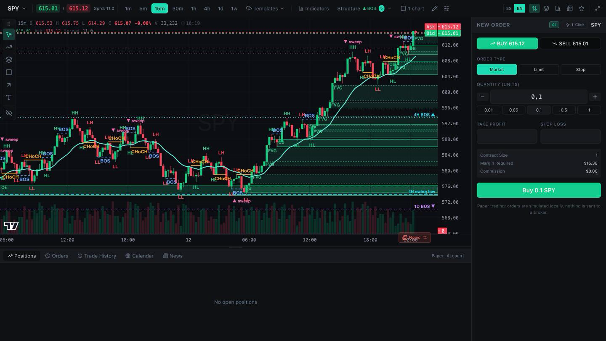

<div align="center">

# 📈 OpenCharts

**An open-source trading terminal for learning: real market data from Alpaca or Interactive Brokers, paper trading in the browser, and market-structure tools with a bilingual guide.**

Advanced charting · drawing tools · indicators · market structure (HH/HL/LH/LL, BOS/CHoCH, FVG, order blocks, liquidity) · 4-timeframe view · watchlist · order ticket · **paper-only** trading engine · Spanish / English



</div>

> **Educational tool.** Orders are always simulated in your browser — the server is read-only and never sends
> orders to a broker. Nothing here is investment advice. Read [docs/LIMITATIONS.md](docs/LIMITATIONS.md) before
> practicing: it lists everything that is simulated or approximate.

---

## Table of contents

- [What is OpenCharts?](#what-is-opencharts)
- [Quick start](#quick-start)
- [Data providers](#data-providers)
  - [Alpaca setup](#alpaca-setup)
  - [IB Gateway setup](#ib-gateway-setup)
- [Features](#features)
- [Market structure and the guide](#market-structure-and-the-guide)
- [Language](#language)
- [How it works](#how-it-works)
- [Project structure](#project-structure)
- [Configuration](#configuration)
- [Scripts](#scripts)
- [Building on OpenCharts](#building-on-opencharts)
- [Built on Lightweight Charts](#built-on-lightweight-charts)
- [Tech stack](#tech-stack)
- [Known limitations](#known-limitations)
- [Contributing](#contributing)
- [Acknowledgements](#acknowledgements)
- [License](#license)

---

## What is OpenCharts?

OpenCharts is a **trading terminal UI** — candlestick chart with a TradingView-style drawing toolbar, indicators,
watchlist, depth-of-market ladder and order ticket — wired to an **in-browser paper-trading engine** funded with
$100,000 and fed with **real market data** by a small local server:

- **Alpaca** — US stocks/ETFs and crypto (a free paper account is enough for market data).
- **Interactive Brokers** — stocks/ETFs, indices and forex through IB Gateway or TWS.
- **Mock** — simulated data, no account needed.

On top of the terminal it brings the tools of the `market-structure` learning project: automatic marking of
**HH/HL/LH/LL, BOS and CHoCH**, optional **FVG, order blocks, EQH/EQL, sweeps, external structure, higher-timeframe
levels, EMAs and daily VWAP**, a **contextual guide** (Spanish and English) that explains each mark with diagrams
and step-by-step examples, and an optional **1D · 4H · 15m · 10m** view.

The terminal itself was extracted from a closed-source prop-trading platform, so a few inherited panels are gated
off or stubbed; they are listed in [Known limitations](#known-limitations).

## Quick start

> Requires **Node 20+**.

```bash
npm install
cp .env.example .env   # choose DATA_PROVIDER=alpaca|ibkr|mock and add your keys
npm run dev            # server (127.0.0.1:3000) + web (http://localhost:5173)
```

No broker account yet? `npm run dev:mock` runs everything with simulated data.

Open <http://localhost:5173>. If the server is not running or the provider is not connected, the app says so and
explains how to fix it.

Production build (one process serves the terminal and the API):

```bash
npm run build
npm start              # http://127.0.0.1:3000
```

## Data providers

The server talks to one provider, chosen with `DATA_PROVIDER` in `.env`. Every provider implements the same
interface (`server/providers.js`), so the terminal works the same with any of them.

| `DATA_PROVIDER` | What it needs | Instruments | Live prices |
| --- | --- | --- | --- |
| `alpaca` (default) | Alpaca API keys (paper or live) | US stocks/ETFs, crypto | Alpaca stream (IEX or SIP) |
| `ibkr` | IB Gateway or TWS running and logged in | Stocks/ETFs, indices, forex | IB market data (delayed without a subscription) |
| `mock` | Nothing | Simulated stocks, forex, crypto | Simulated |

**Symbol names** used by the terminal: `AAPL` (stock/ETF), `EUR.USD` (forex), `BTC/USD` (crypto), `^SPX` (index).
Search any symbol from the chart's symbol picker: results marked **+** are added to your watchlist (saved per
browser). Remove one with the **×** on its watchlist row.

All providers are **read-only**: they request history, symbol lists and quotes only.

### Alpaca setup

1. Create an account at [alpaca.markets](https://alpaca.markets) (a paper account is enough for market data).
2. In the dashboard, open **API Keys** and generate a key pair. Paper and live accounts have separate keys.
3. In `.env`: `DATA_PROVIDER=alpaca`, `ALPACA_API_KEY_ID`, `ALPACA_API_SECRET_KEY`, and `ALPACA_PAPER=0` only if
   they are live keys.
4. `npm run dev`. The server console prints `[alpaca] keys OK`.

Good to know:

- **No forex and no indices** — Alpaca serves FX data to broker partners only. Use IBKR for `EUR.USD`, `^SPX`…
- **Feed**: `ALPACA_FEED=iex` (default, free) covers one exchange, so volume is lower than the consolidated tape;
  `sip` covers all US exchanges but free plans get it 15 minutes delayed.
- With `USE_RTH=1` (default) stock candles are regular-hours only and hourly / 4-hour candles start at 9:30 and
  13:30 New York (built from 30-minute bars), like IB's.

### IB Gateway setup

The server reads market data through the IB API, served by **IB Gateway** (or TWS). IBKR Desktop and Client Portal
do **not** expose the socket API.

1. **Install** IB Gateway *Stable* from
   <https://www.interactivebrokers.com/en/trading/ibgateway-stable.php>.
2. **Log in** choosing **IB API**, then **Paper Trading** (recommended — the paper account has its own username, see
   Client Portal → *Settings* → *Paper Trading Account*) or Live.
3. **API settings** — *Configure → Settings → API → Settings*:

   | Setting | Value |
   | --- | --- |
   | Enable ActiveX and Socket Clients | ✅ |
   | **Read-Only API** | ✅ keep it on: OpenCharts never sends orders |
   | Socket port | `4001` live · `4002` paper (TWS: `7496` live · `7497` paper) |
   | Allow connections from localhost only | ✅ |

4. In `.env`: `DATA_PROVIDER=ibkr` and `IB_PORT` matching the socket port (`IB_HOST` defaults to `127.0.0.1`,
   `IB_CLIENT_ID` to `17` — it must be unique among clients of the same Gateway).
5. `npm run dev`. The server prints `[ib] ready to request data`.

**One session per user**: IBKR allows a single active session per username — logging in to IB Gateway disconnects
TWS / IBKR Desktop / mobile with the same user. Use the paper username or a secondary user for the API.

| Symptom | What to check |
| --- | --- |
| "not connected" in the app | Gateway is open and logged in, the port matches `IB_PORT`, socket clients are enabled |
| Connects and then drops | Another session with the same IBKR user took over |
| "clientId already in use" | Set another `IB_CLIENT_ID` |
| Market-data errors on a symbol | No data subscription: IB delivers delayed data (`IB_MARKET_DATA_TYPE=3`) or rejects some symbols |
| Forex search finds nothing | IB's text search does not return pairs; the 14 IDEALPRO pairs in `server/forex.js` are offered (`EUR.USD`, `eurusd`, `gbp`…) |

## Features

### 📊 Charting
- Candlestick chart on [Lightweight Charts](#built-on-lightweight-charts) v4 with custom plugins; timeframes
  **1m → 1w**; older history loads as you scroll back.
- Volume, OHLC legend, live bid/ask lines, crosshair, bar countdown; toggleable plugins (crosshair highlight,
  session highlighting/breaks, bands, OHLCV and delta tooltips).
- Chart settings, right-click menu, per-symbol drawings and saveable chart templates (all in `localStorage`).

### 📐 Indicators
SMA, EMA, RSI, MACD, Bollinger Bands, ATR, Stochastic and VWAP from the *Indicators* menu, plus the market-structure
overlays described [below](#market-structure-and-the-guide).

### ✏️ Drawing tools
Lines, Fibonacci, shapes, long/short position tools with risk and R:R, text, measure; magnet mode, object tree,
per-object styles and line-cross price alerts.

### 📋 Watchlist · DOM · order ticket
- Editable **watchlist** with live bid/ask, categories and favorites.
- **Order ticket**: market / limit / stop with TP/SL, risk analysis, one-click mode and confirmation dialog.
- Positions / orders / history tabs with modify, partial close and close-all; drag SL/TP on the chart.
- Depth-of-market ladder (sizes are synthetic), calendar and analysis widgets (TradingView embeds).

### 💵 Paper trading (never sent to a broker)
- $100,000 starting balance; **market orders fill at the live ask (buy) / bid (sell)**.
- Positions marked to market on every quote; SL/TP evaluated automatically.
- Leverage per asset type: stocks 4×, forex 30×, crypto 2×. Margin is checked before filling.
- In memory: a reload starts a new paper account.

## Market structure and the guide

The **Structure** button in the chart toolbar shows the current trend (▲ / ▼ and the last break) and opens the tools
ported from `market-structure`:

| Group | Item | What it marks |
| --- | --- | --- |
| Basic (on by default) | HH / HL / LH / LL | Each confirmed swing compared with the previous one of the same type |
| | BOS / CHoCH | Break of the last unbroken swing with (BOS) or against (CHoCH) the trend |
| | `n` and *Break* | Candles on each side to confirm a swing (per timeframe) · break by close or by wick |
| Zones | FVG · Order Blocks | Unfilled 3-candle gaps · last opposite candle before a break of structure |
| Liquidity | EQH / EQL · Sweeps | Nearly equal highs/lows (0.1×ATR) · wicks that take a swing and close back inside |
| Structure | External (n×3) · Higher TF levels | Second, larger swing scale · active swings and last break of 1D / 4H / 15m |
| Context | EMA 10–200 · VWAP (daily) · Volume | Exponential averages · volume-weighted average reset each day |

Every item has a **?** button that opens the **guide**: what it is, how to read it on the chart, the exact rule the
app applies, what to practice, its limits, mini-diagrams and step-by-step examples with scenarios ("if A happens →
how to read it → what to check"). The switches inside the guide turn the overlays on and off without closing it.

**4-timeframe view** — the *1 chart / 4 timeframes* switch shows **1D · 4H · 15m · 10m** side by side, as in
`market-structure`: each panel has its own structure and `n`, higher-timeframe levels flow down to the lower panels,
the crosshair is synced, the layout cycles **4 → 2 → 1** with the `L` key (click a timeframe to choose it,
double-click to maximize) and **Heikin Ashi** candles can be enabled from the Structure menu. Paper orders keep
going through the order panel on the right.

The detection code is pure and tested (`src/lib/structure/`): the original `market-structure` test suite runs
against it unchanged.

## Language

The whole interface and the guide are available in **Spanish and English**. The default comes from `APP_LANG`
(`es` or `en`) in `.env`; each browser can switch with the **ES / EN** buttons in the chart toolbar (saved in
`localStorage`, no reload needed). Texts live in `src/i18n/en.ts` and `src/i18n/es.ts`; both must define the same
keys (checked by TypeScript and by `src/i18n/i18n.test.ts`). The guide content is in `src/lib/guide/`.

## How it works

```
 Browser                                              Local server (server/, Node + Express)
┌───────────────────────────────────────────┐        ┌──────────────────────────────────────────┐
│ Terminal UI (React)                         │  HTTP  │ /api/status   provider status, defaults     │
│  ChartPanel · OrderPanel · Watchlist · DOM  │◄──────►│ /api/symbols  watchlist specs               │
│  Structure menu · Guide · 4-TF view         │  /api  │ /api/search   symbol search                 │
│                                             │        │ /api/candles  history (cached, paced)       │
│ services/server  ── market data client      │   WS   │ /ws           live quotes, per-symbol       │
│ services/ws.ts   ── quotes → bus + engine   │◄──────►│               subscriptions, throttled      │
│ services/paper   ── paper engine, bus       │  /ws   │                                             │
│   (positions, orders, P&L — never sent)     │        │ providers: alpaca.js · ib.js · mock.js       │
└───────────────────────────────────────────┘        └───────────────┬──────────────────────────┘
                                                                         │ read-only
                                                     Alpaca REST + stream │ IB Gateway / TWS socket API
```

- **`server/`** — `providers.js` picks the provider; each one implements `searchSymbols`, `resolve`, `getBars` and
  `subscribeQuotes`. `stream.js` shares one provider subscription per symbol between all browser tabs and throttles
  ticks. Responses are cached; IB historical requests are queued to respect IB's pacing limits.
- **`src/services/api.ts`** — the REST-shaped facade the UI calls. Market-data methods go to the server
  (`services/server/market.ts`); trading methods go to the paper engine (`services/paper/`). Unknown methods inherited
  from the original platform resolve to `null`.
- **`src/services/ws.ts`** — WebSocket client with reconnection. Each quote is published on the in-process bus
  (`market-data` channel, consumed by `MarketDataBridge`) and marks the paper engine's positions to market.
- **Live candles** are built from quotes, anchored to the last history bar so they follow session-based bars
  (stocks open at 9:30 New York).

## Project structure

```
server/                     # read-only market-data server
├─ index.js                 # Express API + static dist/ in production
├─ stream.js                # /ws live quotes hub
├─ providers.js             # alpaca | ibkr | mock
├─ alpaca.js · ib.js · mock.js · forex.js
├─ symbols.js               # app symbol names ⇄ provider descriptors, sessions, specs
├─ timeframes.js · cache.js · config.js (.env)
└─ __tests__/
src/
├─ App.tsx                  # boot: server status, language, paper session, watchlist
├─ i18n/                    # es.ts / en.ts dictionaries, useT(), ES/EN switch
├─ pages/TradingPage.tsx    # terminal layout
├─ pages/trading/           # chart, toolbars, order panel, DOM, watchlist, drawing rail…
├─ components/structure/    # Structure menu, guide panel, 4-TF view, chart overlay hook
├─ lib/structure/           # structure + indicators (pure, tested), drawing primitive, settings store
├─ lib/guide/               # guide content (es/en), examples, SVG diagrams
├─ lib/chart-plugins/       # Lightweight Charts plugins and the drawing engine
├─ services/
│  ├─ server/               # HTTP client for /api, watchlist storage
│  ├─ paper/                # paper engine, event bus, symbol registry, api table
│  ├─ api.ts · ws.ts · queries.ts · store.tsx · schemas.ts
└─ hooks/ · components/ · styles/
docs/LIMITATIONS.md         # what is simulated or approximate
```

## Configuration

Server settings go in `.env` (see [.env.example](.env.example)); shell variables win over `.env`.

| Variable | Default | Meaning |
| --- | --- | --- |
| `DATA_PROVIDER` | `alpaca` | `alpaca`, `ibkr` or `mock` (`MOCK=1` also forces mock) |
| `APP_LANG` | `es` | Default interface language (`es` or `en`) |
| `WATCHLIST` | per provider | Comma-separated watchlist for a new browser (`SPY,AAPL,BTC/USD`) |
| `USE_RTH` | `1` | `1` = regular trading hours only for stocks/indices, `0` = include pre/post market |
| `ALPACA_API_KEY_ID` / `ALPACA_API_SECRET_KEY` | empty | Alpaca keys |
| `ALPACA_PAPER` | `1` | `1` = paper keys, `0` = live keys |
| `ALPACA_FEED` | `iex` | `iex` or `sip` |
| `IB_HOST` / `IB_PORT` / `IB_CLIENT_ID` | `127.0.0.1` / `4001` / `17` | IB Gateway / TWS connection |
| `IB_MARKET_DATA_TYPE` | `3` | `1` live (needs a subscription), `3` delayed |
| `PORT` / `HOST` | `3000` / `127.0.0.1` | Local server; keep it on localhost |

Front-end (optional): `VITE_POSTHOG_API_KEY` / `VITE_POSTHOG_HOST` enable PostHog analytics — unset (the default)
means analytics are never initialized. The calendar and technical-analysis widgets load TradingView embed scripts
(third-party requests).

## Scripts

| Command | Description |
| --- | --- |
| `npm run dev` | Server + web together (Vite proxies `/api` and `/ws` to the server) |
| `npm run dev:mock` | Same with simulated data |
| `npm run server` / `npm run server:mock` | Server only (restarts on changes in `server/`) |
| `npm run web` | Web only |
| `npm run build` | Production build to `dist/` |
| `npm start` | Server serving the API and `dist/` on `127.0.0.1:3000` |
| `npm test` / `npm run test:watch` | Vitest (front-end, server, structure and i18n tests) |
| `npm run typecheck` | `tsc` (see limitations: inherited code still has errors) |

## Building on OpenCharts

`npm test` is the gate; TypeScript runs in `strict` mode with `noUncheckedIndexedAccess`, and `@/` resolves to `src/`.

- **Add a data provider** — implement the interface documented at the top of `server/providers.js` and register it
  in `FACTORIES`. Use `server/mock.js` as the smallest example; keep it read-only.
- **Add a market-structure overlay** — pure detection in `src/lib/structure/indicators.ts` (with a test), selection in
  `computeOverlay()` (`compute.ts`), drawing in `primitive.ts`, a key in `IND_KEYS` (`store.ts`), a row in
  `StructureMenu.tsx` and a guide entry in `src/lib/guide/help.es.ts` / `help.en.ts`.
- **Add an indicator** — calculation in `src/lib/indicators.ts`, entry in `INDICATOR_REGISTRY`, series in
  `pages/trading/useIndicators.ts`, label key `ind.<TYPE>` in the dictionaries.
- **Add a drawing tool** — `pages/trading/constants.ts` (type), `drawing-tools/manager.ts`, `renderers.ts`,
  `hit-test.ts`, `DrawingToolRail.tsx`, and a `tool.<name>` label key.
- **Add UI text** — add the key to both `src/i18n/en.ts` and `src/i18n/es.ts` and read it with `useT()`.

Where state lives: zustand (`services/store.tsx` trading state, `lib/structure/store.ts` structure settings,
`i18n` language), TanStack Query (everything fetched), the in-process bus (`market-data`, `positions`, `orders`,
`account`) and `localStorage` (watchlist `oc_watchlist`, selected symbol, drawings `oc_drawings_<SYMBOL>`, chart
templates and preferences, structure settings `oc_structure`, language `oc_lang`).

Gotchas: `api` resolves unknown methods to `null` (a typo fails silently); React runs in `StrictMode`, so chart
effects mount twice in development and need clean-ups; the paper engine is in memory.

## Built on Lightweight Charts

OpenCharts is **built on top of TradingView's
[Lightweight Charts™](https://github.com/tradingview/lightweight-charts)** (`lightweight-charts` `^4.2.0`, which pulls
in `fancy-canvas`, MIT). The chart canvas, series, panes, price scales, crosshair and time axis are Lightweight
Charts; OpenCharts is the terminal around it. Several plugins under `src/lib/chart-plugins/` are adapted from the
`plugin-examples` of the Lightweight Charts repository and carry that project's license.

### Licensing — read this before you fork or deploy

- Lightweight Charts is licensed under the
  [Apache License 2.0](https://github.com/tradingview/lightweight-charts/blob/master/LICENSE).
- **Attribution is required**: the notice from TradingView's `NOTICE` file and a link to
  <https://www.tradingview.com/> must be visible to users:

  ```
  TradingView Lightweight Charts™
  Copyright (с) 2025 TradingView, Inc. https://www.tradingview.com/
  ```

- OpenCharts satisfies this with the chart's built-in attribution logo (`attributionLogo`, default `true`, never
  overridden — including in the 4-timeframe view). Do not disable it unless you show the notice and link elsewhere.
- Keep the license and notice when you redistribute, including the adapted plugin code.
- OpenCharts' own code is MIT ([LICENSE](LICENSE)); MIT and Apache 2.0 are compatible.

None of this is legal advice.

## Tech stack

- **React 19** + **TypeScript 5.7** + **Vite 6**; **lightweight-charts 4** with custom plugins
- **Zustand** and **TanStack Query**; **Tailwind CSS 3** + **Radix UI** + **lucide-react**
- Server: **Node** + **Express 5**, **ws**, **dotenv**, **@stoqey/ib** (IB API)
- **Vitest** + **Testing Library**

## Known limitations

The complete, maintained list is in **[docs/LIMITATIONS.md](docs/LIMITATIONS.md)** (providers, sessions, paper
engine, market-structure tools, interface and repository status). The main ones:

- Paper only: limit/stop tickets fill immediately; no slippage, commissions or swap; the account resets on reload.
- Alpaca has no forex or indices; IBKR without a data subscription is delayed; Alpaca and IBKR were only tested
  against fake APIs while building them.
- Stock ticks outside regular hours are dropped with `USE_RTH=1`; the chart time axis is UTC.
- The DOM sizes and the news tab are placeholders.
- Inherited, unreachable panels: session replay, trade journal, AI trader, trade calculator, prop-firm challenge
  levels.

## Contributing

Issues and pull requests are welcome. Good places to start: a resting-order book for the paper engine, persistence
of the paper account, more data providers, more structure overlays (with a guide entry in both languages), tests,
and finishing or removing the dormant panels. Run `npm test` before opening a PR and keep broker integrations
read-only.

## Acknowledgements

- TradingView's open-source [Lightweight Charts™](https://github.com/tradingview/lightweight-charts) and its plugin
  examples render every chart here.
- The original **OpenCharts** terminal (`dylanpersonguy/OpenCharts`), on which this learning version is built.
- The **market-structure** project, source of the provider strategy, the structure detection, its tests and the
  contextual guide.

## License

OpenCharts is released under the **MIT License** — see [LICENSE](LICENSE). It bundles TradingView's Lightweight
Charts™ (Apache License 2.0), whose attribution notice and link must stay visible to your users; see
[Built on Lightweight Charts](#built-on-lightweight-charts).
